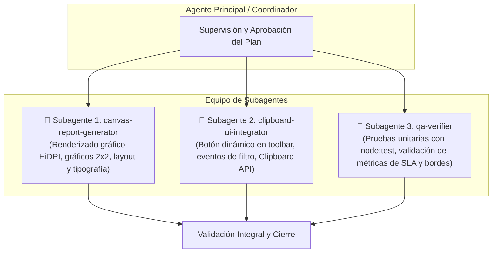

# Plan de Implementación: Botón "Copiar Reporte" en Indicadores (Imagen + Texto por Contratista)

> **Para trabajadores agenticos:** SUB-SKILL REQUERIDO: Usar `subagent-driven-development` o `executing-plans` para ejecutar este plan tarea por tarea. Los pasos usan sintaxis de casillas (`- [ ]`) para seguimiento.

**Meta:** Implementar un botón reactivo en el tablero de Indicadores que se habilita únicamente al seleccionar una empresa contratista, generando y copiando al portapapeles tanto una imagen compuesta en alta definición (con el logo de Pluz, los 4 gráficos ordenados en cuadrícula 2x2 y el texto resumen inferior) como el texto plano estructurado listo para WhatsApp/Teams.

**Arquitectura:**
- Módulo generador gráfico en cliente (`assets/js/25-contractor-report.js`): calcula las métricas operativas del contratista seleccionado y renderiza en un `HTML5 Canvas` HiDPI (escala 2x para nitidez cristalina) la tarjeta completa (logo Pluz, KPIs, 4 gráficos de barras con paleta institucional y bloque de texto inferior formateado).
- Integración en barra de filtros (`index.html` y `assets/js/20-dashboard.js`): detecta de forma reactiva la selección única de empresa (vía selector `Empresa / Contratista` o clic en las barras interactivas del gráfico), habilitando el botón con el nombre dinámico del contratista (ej. `📋 Copiar Reporte [DOMINION]`).
- Motor de Portapapeles (`Clipboard API`): inyecta de forma atómica en el portapapeles el item binario `image/png` y el item textual `text/plain`, garantizando que al presionar `Ctrl + V` en WhatsApp Web o Teams se pegue la imagen, con opción secundaria para copiar solo texto si se requiere.

**Tech Stack:** JavaScript Vanilla (ES6+), HTML5 Canvas 2D API, Web Clipboard API (`navigator.clipboard.write`), CSS3, Node.js Test Runner (`node:test`).

---

## Definición de Subagentes Requeridos

Para asegurar modularidad, calidad visual y cobertura de pruebas, se asignarán 3 subagentes especializados:



1. **Subagente 1: `canvas-report-generator` (Especialista en Canvas y Diseño Visual)**:
   - **Misión:** Diseñar la función constructora que produce la imagen PNG idéntica a la muestra:
     - Cabecera con logo `PLUZ.png` y badges de estado.
     - Grilla 2x2 de los 4 gráficos: *Evolución diaria*, *Carga por contratista*, *Composición por tipo de falla* y *Antigüedad de los casos*.
     - Bloque inferior tipográfico con la alineación exacta de viñetas, fuentes y métricas.
     - Conversión fluida a `Blob` (PNG) en memoria sin sobrecargar la CPU.

2. **Subagente 2: `clipboard-ui-integrator` (Especialista en UI y Flujo de Portapapeles)**:
   - **Misión:** Integrar el componente en la interfaz de Indicadores:
     - Botón `btnCopyContractorReport` en `index.html` y estilos en `90-modern.css`.
     - Monitoreo reactivo del estado de filtros en `20-dashboard.js`: si hay 0 o >1 empresas, se deshabilita; si hay exactamente 1 empresa seleccionada, se activa mostrando su nombre.
     - Menú o botón rápido: acción principal (Copiar Imagen + Texto) y opción complementaria (Copiar Solo Texto para WhatsApp).
     - Feedback al usuario mediante el toast del sistema (`showNotificationToast`).

3. **Subagente 3: `qa-verifier` (Especialista en Testing y Robustez)**:
   - **Misión:** Crear y ejecutar la suite de pruebas automatizadas en `tests/contractor-report-copy.test.js`:
     - Verificación matemática de las reglas de negocio (Reparaciones vs Reclamos, tickets +24h, tickets en riesgo, fuera de plazo por 12h, 8h y 4h).
     - Manejo de casos de borde (cero incidencias, contratistas sin datos, cadenas largas).
     - Comprobación de integridad estructural en el DOM y funciones expuestas.

---

## Reglas de Cálculo de Métricas del Resumen

A partir del dataset filtrado para el contratista seleccionado (`records`):

```text
Estimados Buenas tardes/días [CONTRATISTA]
Reporte de Pendientes [FECHA] [HORA]
· Reparaciones: [N_REPARACIONES]
· Reclamos: [N_RECLAMOS]
TICKETS +24 HRS: [N_MAS_24H]
TICKETS EN RIESGO: [N_RIESGO]
· OA FUERA DE PLAZO (>12 hrs): [N_OA_FP]
· CNX FUERA DE PLAZO (>8 hrs): [N_CNX_FP]
· RECLAMOS FUERA DE PLAZO (>4 hrs): [N_REC_FP]
```

1. **Saludo**: Según la hora local (`Buenos días` si < 12:00, `Buenas tardes` si 12:00 a 19:00, `Buenas noches` si >= 19:00).
2. **Fecha y Hora**: `DD/MM/AAAA HH:MM` (de la última sincronización o timestamp actual).
3. **Reparaciones**: Fallas asociadas a redes (`RED AEREA`, `RED SUBTERRANEA`, `CNX AEREA`, `CNX SUBTERRANEA`, `POSTE`, `FUSIBLE`).
4. **Reclamos**: Fallas asociadas a usuarios particulares (`SUMINISTRO`, `MEDIDOR`, `ACOMETIDA`).
5. **TICKETS +24 HRS**: Incidencias cuya duración transcurrida sea `>= 24.0 horas` (o intervalo en `>24 hrs` / `24-48 hrs`).
6. **TICKETS EN RIESGO**: Incidencias con SLA entre 75% y 100% o prioridad `RIESGO` / `VIDA`.
7. **OA FUERA DE PLAZO (>12 hrs)**: Casos de Red Subterránea / Ordenes de Avería con SLA vencido o `duracion > 12`.
8. **CNX FUERA DE PLAZO (>8 hrs)**: Casos de Conexiones Aéreas / Subterráneas vencidas o `duracion > 8`.
9. **RECLAMOS FUERA DE PLAZO (>4 hrs)**: Casos de Suministro vencidos o `duracion > 4`.

---

## Archivos Involucrados

| Operación | Archivo | Responsabilidad |
| :--- | :--- | :--- |
| **[NUEVO]** | `assets/js/25-contractor-report.js` | Motor de cálculo de métricas, plantilla de texto, renderizador en Canvas 2D y exportador de imagen Blob. |
| **[NUEVO]** | `tests/contractor-report-copy.test.js` | Pruebas unitarias de cálculo de métricas, formato de reporte y reglas de habilitación del botón. |
| **[MODIFICAR]** | `index.html` | Inclusión del botón de copiar en `filters-toolbar` de Indicadores y carga del script `25-contractor-report.js`. |
| **[MODIFICAR]** | `assets/js/20-dashboard.js` | Conexión del botón con el estado del filtro `tdCtrlEmpresa` y manejo de eventos de clic. |
| **[MODIFICAR]** | `assets/css/90-modern.css` | Estilos visuales del botón activo/deshabilitado y grupo de botones de copiado. |

---

## Tareas Detalladas de Implementación

### Tarea 1: Motor de Cálculo y Renderizado Canvas (`25-contractor-report.js`)
**Asignado a:** `canvas-report-generator`
- [ ] **Paso 1.1:** Escribir prueba unitaria básica en `tests/contractor-report-copy.test.js` para las funciones de cálculo de métricas.
- [ ] **Paso 1.2:** Implementar `buildContractorSummaryData(contractorName, records)` que procesa y extrae todos los números del reporte.
- [ ] **Paso 1.3:** Implementar `buildContractorSummaryText(summaryData)` que genera la cadena textual formateada idéntica al modelo.
- [ ] **Paso 1.4:** Implementar `renderContractorReportCanvas(summaryData, records)` que dibuja en un canvas 2x HiDPI:
  - Cabecera con logo `PLUZ.png` y badges de Total / Dentro de plazo.
  - 4 sub-gráficos en cuadrícula 2x2 (Evolución diaria, Empresa, Falla, Antigüedad) con barras proporcionales y etiquetas legibles.
  - Bloque inferior de texto con tipografía sans-serif oscura y separación de columnas.
- [ ] **Paso 1.5:** Implementar `copyContractorReportToClipboard(contractorName, records)` que une la imagen generada y el texto en `navigator.clipboard.write([new ClipboardItem(...)])`.

### Tarea 2: Interfaz Visual y Reactividad de Filtros (`index.html` & `20-dashboard.js`)
**Asignado a:** `clipboard-ui-integrator`
- [ ] **Paso 2.1:** Añadir el grupo de botones de copiado en `index.html` dentro de la barra de herramientas de Indicadores (`.filters-toolbar`).
- [ ] **Paso 2.2:** Aplicar estilos en `assets/css/90-modern.css` para el botón (estado deshabilitado con cursor `not-allowed`, estado activo brillante con icono de portapapeles y animación suave).
- [ ] **Paso 2.3:** En `assets/js/20-dashboard.js`, suscribir la actualización del botón dentro de `applyDashboardFilters` y `refreshDashboard`.
  - Si `tdCtrlEmpresa.getSelected().length === 1`, activar botón y actualizar texto a: `📋 Copiar Reporte [${empresa}]`.
  - Si es 0 o >1, deshabilitar botón con tooltip explicativo.
- [ ] **Paso 2.4:** Vincular el clic del botón a `copyContractorReportToClipboard`, mostrando confirmación con `showNotificationToast("✅ Reporte e imagen copiados al portapapeles")`.
- [ ] **Paso 2.5:** Añadir menú rápido o botón contiguo `📝 Solo Texto` para máxima flexibilidad al usuario.

### Tarea 3: Verificación Automatizada y Validación Integral
**Asignado a:** `qa-verifier`
- [ ] **Paso 3.1:** Ejecutar suite completa con `node --test tests/contractor-report-copy.test.js`.
- [ ] **Paso 3.2:** Ejecutar la suite completa de tests existentes (`node --test tests/*.test.js`) para asegurar cero regresiones.
- [ ] **Paso 3.3:** Validación manual en navegador con el dataset real de `data_tecnicos.json`, probando la selección de `DOMINION`, `LARI`, etc., y verificando que el pegado en WhatsApp/Teams sea idéntico a la muestra.

---

## Plan de Verificación

### Pruebas Automatizadas
```bash
node --test tests/contractor-report-copy.test.js
node --test tests/*.test.js
```

### Verificación Manual
1. Abrir la aplicación y navegar a la pestaña **Indicadores**.
2. Verificar que inicialmente el botón **Copiar Reporte** esté deshabilitado.
3. Filtrar por una empresa contratista (ej. `DOMINION`).
4. Comprobar que el botón se activa de inmediato: **`📋 Copiar Reporte [DOMINION]`**.
5. Hacer clic en el botón.
6. Ir a WhatsApp Web (o aplicación de notas/Teams) y presionar `Ctrl + V`.
7. Verificar que se pegue la imagen compuesta nítida con los 4 gráficos y el texto en la base, y que los números coincidan con la data real.
