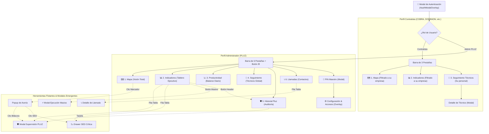

# FASE 2A: Arquitectura de Información Actual
**Proyecto:** OMS Map — Pluz Energía  
**Rol:** Senior Product Director & Lead UX/UI Information Architect  
**Entregable:** `ux_audit/02_current_architecture.md`

---

## 1. Diagrama de la Estructura de Navegación Actual

Actualmente, OMS Map implementa un modelo de navegación plano basado en una barra superior fija con **6 pestañas de primer nivel**. Cada pestaña no carga una ruta URL real (no hay enrutamiento con hash o History API), sino que conmuta la visibilidad de capas superpuestas (*full-screen overlays*) sobre el contenedor base del mapa.



---

## 2. Modelo de Interacción y Comportamiento de Pantallas

### 2.1. El Paradigma "Mapa como Fondo Permanente + Modales Pantalla Completa"
En el diseño actual, el mapa Leaflet (`#map`) se renderiza en el nivel `z-index: 1`. Cuando el usuario hace clic en cualquier otra pestaña (`Indicadores`, `Productividad`, `Seguimiento`, `Historial Pluz`, `Llamadas` o `Configuración`), el sistema no navega a una nueva página ni desmonta el mapa: activa un contenedor `div` con clase `.td-oms-full-view` que cubre el 100% del viewport mediante `position: fixed; z-index: 2000; background: #ffffff;`.

#### Implicaciones de este modelo:
1. **Pérdida de Continuidad Cartográfica:** Cuando el operador entra a "Indicadores" o "Seguimiento", la cartografía desaparece por completo detrás de una sábana blanca opaca. No existe una vista híbrida (ej. mapa a la izquierda + métricas a la derecha).
2. **Desorientación de Botones de Salida:** Las vistas secundarias incluyen botones redundantes como `Volver al mapa`, `Cerrar`, o la propia pestaña superior, obligando al usuario a procesar múltiples vías para hacer lo mismo.
3. **Ausencia de Estado en URL:** Si el operador recarga el navegador (`F5`), la aplicación siempre regresa a la vista inicial del Mapa, perdiendo filtros aplicados, la pestaña donde estaba trabajando o el ticket que estaba inspeccionando.

---

## 3. Topología de Filtros y Búsquedas (El Problema de la Fragmentación)

Uno de los hallazgos arquitectónicos más críticos es la **multiplicación de barras de filtros independientes** que operan sobre la misma base de datos pero no sincronizan su estado:

| Superficie | Mecanismo de Búsqueda | Filtros Disponibles | Sincronización con otras vistas |
| :--- | :--- | :--- | :--- |
| **Mapa** | Input con selector: Ticket, SED, Alimentador, Dirección. | • Multi-select: Día, Estado, Empresa, Falla.<br>• Checkboxes: ≥7 Llamadas, SED >2, Sum ≥2, Top Críticas. | ❌ Ninguna. Los filtros aplicados en el mapa no se transfieren al cambiar a Indicadores. |
| **Indicadores** | Buscador de texto libre exclusivo para la tabla inferior. | • Multi-select: Día, Intervalo, Empresa, Falla, Estado.<br>• Checkboxes: ≥7 Llamadas, SED >2, Sum ≥2, Top Críticas, Excedidos de tiempo, Quántico/Crítico. | ❌ Ninguna. Si filtras por "COBRA" aquí, al volver al mapa ves todas las empresas. |
| **Seguimiento Técnicos** | Buscador global de técnicos por nombre o ticket. | • Dropdowns individuales: Fecha, Empresa, Técnico, Skill, Zona, Estado. | ❌ Aislada completamente de mapa e indicadores. |
| **Historial Pluz** | Buscador de texto por SED, Ticket, JC o detalle. | • Chips rápidos: Todos, Quánticos, Críticos.<br>• Badge de SED activa. | ❌ Aislada. |
| **Llamadas** | Buscador por aviso, ticket, suministro o distrito. | • Dropdowns: Frecuencia de llamadas, Estado del aviso. | ❌ Aislada. |

> **Diagnóstico:** Existen **5 barras de búsqueda distintas y 4 sistemas de filtrado desconectados**. Un usuario que identifica una incidencia crítica en el Mapa debe volver a escribir el número de ticket o volver a filtrar la contratista cuando cambia a la pestaña de Indicadores o de Técnicos.

---

## 4. Distribución de Acciones y Modales Secundarios

El sistema presenta una arquitectura altamente "modal-céntrica", donde las acciones críticas no ocurren en el flujo principal sino en ventanas emergentes flotantes:

```
[Vista Principal]
  │
  ├──► [Modal Supervisión Individual] (#supervisorModalOverlay)
  │      └──► Se abre desde: Popup de Mapa, Fila de Indicadores, Tarjeta de Historial
  │      └──► Contiene: JC, Fin Estimado, Estado Operativo, Criticidad, Historial cronológico
  │
  ├──► [Modal Registro Masivo] (#bulkPluzModalOverlay)
  │      └──► Se abre desde: Botón verde "⚡ EJECUCION (PLUZ)" en tabla de Indicadores
  │      └──► Contiene: Textarea para pegar desde Excel, Parser de tickets, Preview reactivo
  │
  ├──► [Modal Detalle de Técnico] (#techDetailModalOverlay)
  │      └──► Se abre desde: Fila en tabla de Seguimiento de Técnicos
  │      └──► Contiene: Timeline de jornada, KPIs de ritmo, tabla de tickets con exportador
  │
  ├──► [Drawer Lateral de SED Crítica] (#criticalSedDrawer)
  │      └──► Se abre desde: Popup de Mapa, Fila de Indicadores, Fila de Seguimiento del Día
  │      └──► Contiene: Gráficos 1Y/6M/3M/1M/7D, selector de falla, llaves
  │
  └──► [Modal de Configuración] (#configAdminModalOverlay)
         └──► Requiere: Desbloqueo previo por PIN (#configPinModalOverlay)
         └──► Contiene: Tabla de usuarios y claves editables sincronizadas con Sheets
```

---

## 5. Matriz de Permisos por Rol

La arquitectura condiciona drásticamente la interfaz según la autenticación obtenida en el backend:

```
                  ┌──────────────────────────────────────────────────┐
                  │                 SESIÓN INICIADA                  │
                  └─────────────────────────┬────────────────────────┘
                                            │
                     ┌──────────────────────┴──────────────────────┐
                     ▼                                             ▼
          ┌─────────────────────┐                       ┌─────────────────────┐
          │   ROL CONTRATISTA   │                       │      ROL ADMIN      │
          │ (COBRA, LARI, etc.) │                       │       (PLUZ)        │
          └──────────┬──────────┘                       └──────────┬──────────┘
                     │                                             │
      ┌──────────────┴──────────────┐               ┌──────────────┴──────────────┐
      ▼              ▼              ▼               ▼              ▼              ▼
  [ Mapa ]     [ Indicadores ] [ Seguimiento ]  [ Todas las     [ Botón ⚙️     [ Herramientas ]
  (Filtrado     (Filtrado a     (Filtrado a      6 Pestañas ]    Configuración]  (Supervisión,
  a su empresa)  su empresa)     su personal)                                     Masivo, Críticas)
```

### Problemas arquitectónicos del control por rol actual:
1. **Sensación de "Mutilación" en Contratistas:** La interfaz no se adapta orgánicamente; simplemente oculta botones dejando espacios vacíos o barras desbalanceadas.
2. **Admin con Sobrecarga Visual:** El usuario PLUZ recibe de golpe 6 pestañas, 4 badges numéricos en cabecera, 2 botones de descarga masiva CSV, 1 botón de config y múltiples toolbars en cada sección, elevando la carga cognitiva a niveles excesivos.

---

## 6. Conclusión de la Fase 2A

La arquitectura actual responde a un crecimiento incremental donde cada nueva funcionalidad (Llamadas, Productividad, Historial, SEDs Críticas) fue añadida como una **nueva pestaña principal** o un **nuevo modal flotante**.

En el siguiente documento (`ux_audit/03_ux_audit.md`) evaluaremos esta estructura bajo las heurísticas de Nielsen y los principios de diseño de producto de Impeccable (`critique`, `distill`).
