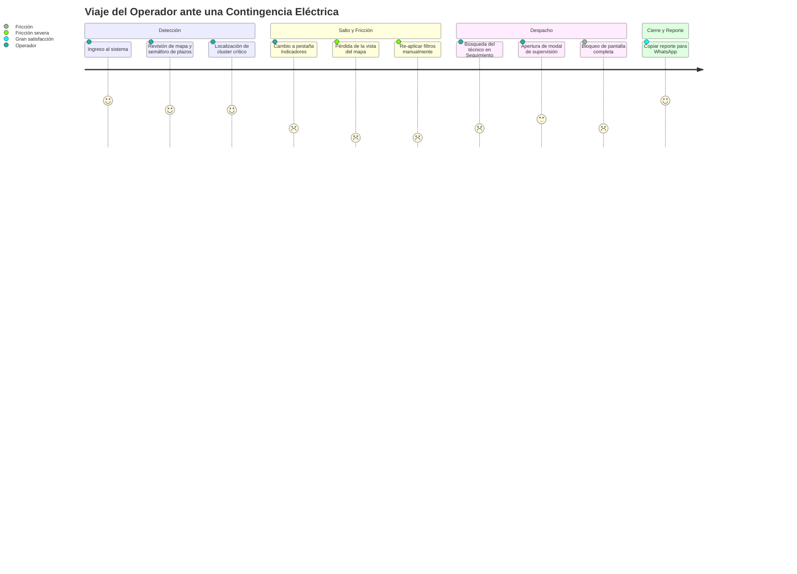

# FASE 2B: Auditoría Crítica de UX y Arquitectura de Información
**Proyecto:** OMS Map — Pluz Energía  
**Rol:** Senior Product Director & Lead UX/UI Information Architect  
**Entregable:** `ux_audit/03_ux_audit.md`  
**Metodología:** Impeccable Design Audit (`critique` + `distill`), 10 Heurísticas de Nielsen, Carga Cognitiva y Análisis de Flujos Operativos.

---

## 1. Veredicto del Director de Producto

> **Veredicto:** **Alta riqueza funcional atrapada en una arquitectura fragmentada por agregación histórica.**
> 
> OMS Map posee todas las herramientas y capacidades necesarias para liderar el despacho y análisis de averías eléctricas de Pluz Energía. Sin embargo, sufre del síndrome clásico de los sistemas empresariales maduros: **cada nueva necesidad de negocio se resolvió agregando una pestaña más en la barra superior o abriendo un modal encima de otro**.
> 
> El resultado es una interfaz que obliga al operador a realizar constantes "saltos de contexto" (*context switching*), memorizar qué filtro aplicó en qué vista y gestionar hasta tres capas superpuestas de ventanas. La aplicación necesita una **destilación profunda (`distill`) y una reestructuración basada en el flujo real del despachador y la jefatura**.

---

## 2. Evaluación Crítica: Preguntas Fundamentales

### ¿Hay demasiadas pestañas principales?
**Sí, rotundamente.**
Tener **6 pestañas de primer nivel** (`Mapa`, `Indicadores`, `Productividad`, `Seguimiento`, `Historial Pluz`, `Llamadas`) compitiendo en la misma fila horizontal viola la ley de Miller (7±2) y genera fatiga visual en pantallas de control operativo.
- No hay distinción entre lo que es **operación en vivo** (Mapa y Despacho), **gestión de recursos** (Cuadrillas y Supervisión) e **inteligencia analítica** (Indicadores, Productividad y Llamadas).
- En pantallas de resolución media (1366x768 de laptops corporativas) o en tablets de campo, las 6 pestañas se comprimen o desbordan la cabecera.

### ¿Existen pestañas que deberían fusionarse?
**Sí, existen dos fusiones críticas e imperativas:**
1. **Fusión Analítica: `Indicadores` + `Productividad`**
   - Ambas pantallas responden a la misma pregunta del usuario: *¿Cómo va el cumplimiento de plazos y cuál es el balance de carga de trabajo?*
   - Actualmente, el operador debe mirar `Indicadores` para ver el semáforo y los 4 gráficos de falla/antigüedad, y luego saltar a `Productividad` para ver el gráfico de cascada (*Waterfall*) y los ingresos vs. cierres. Es una división artificial que fragmenta la toma de decisiones.
2. **Fusión de Operaciones de Campo: `Seguimiento (Técnicos)` + `Historial Pluz (Supervisión)`**
   - `Seguimiento` monitorea a los técnicos individuales y su ritmo de liquidación.
   - `Historial Pluz` audita las notas de los Jefes de Cuadrilla (JC) y las SEDs críticas asignadas.
   - Ambos módulos pertenecen al mismo dominio: **Despacho, Control de Cuadrillas y Bitácora de Campo**. Mantenerlos separados como silos obliga al supervisor a triangular datos manualmente.

### ¿Hay funcionalidades que deberían ser submenús o agruparse bajo perfiles?
- **Botón `⚙️ Configuración` y Acciones de Usuario:** El botón `⚙️` y el botón `🚪` están colocados como botones sueltos al lado del nombre de usuario. Deben consolidarse dentro de un **Menú de Perfil de Usuario** desplegable (*User Dropdown*), que contenga:
  - Identificación del perfil activo y empresa.
  - Acceso a Configuración de Accesos / Credenciales (protegido por PIN).
  - Preferencias de visualización (modo mapa oscuro/claro).
  - Cerrar sesión.
- **Botones de Descarga CSV (`📥 Pend.` y `📥 Ejec.`):** Ocupan un espacio horizontal privilegiado en la cabecera principal permanente. La descarga masiva de CSV en bruto es una acción utilitaria secundaria, no una tarea que el operador realiza cada minuto. Deben residir en un menú de **Exportaciones / Herramientas de Datos**.

### ¿Hay opciones que deberían estar dentro de menús desplegables o paneles secundarios?
- **Filtros rápidos de checkboxes en el Mapa (`≥7 Llamadas`, `SED >2`, `Sum ≥2`, `Top Críticas`):**
  Actualmente están expuestos en una fila desordenada junto a la barra de búsqueda, con diferentes colores de fondo (`#fff1f2`, `#fef2f2`, `#ccfbf1`, `#fef3c7`), generando un efecto de "árbol de navidad" que distrae de la cartografía.
  Deben consolidarse en un desplegable unificado de **"Filtros de Severidad / Criticidad"** o badges toggle compactos con lenguaje visual homogéneo.

### ¿Hay secciones que deberían convertirse en herramientas contextuales?
**Sí, fundamentalmente dos:**
1. **Bitácora de Supervisión PLUZ (`#supervisorModalOverlay`):**
   Actualmente es un modal emergente centrado que bloquea por completo la vista del mapa o de la tabla. Cuando un supervisor escribe una novedad o asigna un JC, **necesita seguir viendo la ubicación de la avería, las calles aledañas y las SEDs vecinas**. Debe transformarse en un **Panel Lateral Contextual (*Slide-over Drawer*)**.
2. **Análisis de SED Crítica (`#criticalSedDrawer`):**
   Aunque ya funciona como un drawer lateral, su apertura es inconsistente y compite con los modales abiertos. Debe estandarizarse como un panel contextual universal acoplable.

### ¿Existen funcionalidades duplicadas?
1. **Buscadores Múltiples Desconectados:** Hay un buscador en el Mapa, otro en la tabla de Indicadores, otro global en Técnicos, otro en Historial y otro en Llamadas. Ninguno comparte el término buscado.
2. **Filtros Redundantes:** El usuario selecciona "Empresa: COBRA" en el Mapa, pero cuando entra a Indicadores, la tabla vuelve a mostrar todas las empresas a menos que vuelva a seleccionar "COBRA" en el segundo filtro.
3. **Contadores de Incidencias:** El badge `Pend. BT` de cabecera a veces discrepa visualmente del total de casos filtrados en la tabla de Indicadores o de los casos mostrados en las tarjetas de KPIs.

### ¿La navegación refleja realmente cómo trabaja el usuario?
**No.** La navegación actual refleja la **arquitectura del código y las bases de datos de Google Sheets**, no la psicología del operador.
- El flujo natural de un despachador es:
  `1. Panorama Operativo (Mapa)` ➔ `2. Focalización de Caso Crítico` ➔ `3. Asignación y Supervisión` ➔ `4. Verificación de Cumplimiento de Plazo`.
- La estructura actual lo fuerza a una navegación en zigzag:
  `Pestaña Mapa` ➔ `Clic Marcador` ➔ `Modal Supervisión` ➔ `Cerrar Modal` ➔ `Pestaña Indicadores` ➔ `Filtrar de nuevo` ➔ `Modal Ejecución Masiva` ➔ `Pestaña Seguimiento`.

---

## 3. Evaluación Heurística de Nielsen (Escala 0 a 4)

| Heurística | Puntaje | Diagnóstico en OMS Map |
| :--- | :---: | :--- |
| **H1: Visibilidad del estado del sistema** | **2/4** | *Aceptable pero inconsistente.* El semáforo de plazos (verde/ámbar/rojo) es excelente. Sin embargo, cuando los datos se sincronizan o fallan, el estado `appDataStatus` a veces pasa desapercibido y el usuario no sabe si los datos tienen 2 minutos o 1 hora de antigüedad salvo por el texto diminuto de cabecera. |
| **H2: Correspondencia entre el sistema y el mundo real** | **3/4** | *Fuerte.* El uso estricto del término `plazo` en lugar de `SLA`, y conceptos como `SED`, `Alimentador` y `Jefe de Cuadrilla` corresponden fielmente al lenguaje de campo de Pluz Energía. |
| **H3: Control y libertad del usuario** | **2/4** | *Rígido.* El operador queda atrapado en modales full-screen sin poder consultar el mapa simultáneamente. No hay soporte para botón "Atrás" del navegador (`History API`). Presionar la tecla `Esc` no siempre cierra las capas en orden predecible. |
| **H4: Consistencia y estándares** | **2/4** | *Deficiente.* Hay botones con emojis (`📸`, `📊`, `📝`, `⚡`, `⚙️`, `🚪`, `🔍`), botones con texto en mayúsculas, filtros tipo píldora, filtros desplegables de Bootstrap-like y checkboxes nativos, todo conviviendo en la misma aplicación. |
| **H5: Prevención de errores** | **3/4** | *Buena.* El bloqueo por PIN maestro para la configuración de contraseñas previene modificaciones accidentales en Google Sheets. |
| **H6: Reconocimiento antes que recuerdo** | **1/4** | *Grave.* Al no persistir los filtros entre pestañas, el usuario debe recordar qué empresa, día o tipo de falla estaba analizando cada vez que conmuta entre el Mapa, Indicadores o Productividad. |
| **H7: Flexibilidad y eficiencia de uso** | **3/4** | *Muy buena en atajos operativos.* El generador de reportes al portapapeles (`📸 Reporte Completo`) y el importador masivo desde Excel (`⚡ EJECUCION (PLUZ)`) son características excepcionales de productividad. |
| **H8: Estética y diseño minimalista** | **1/4** | *Sobrecargado.* Demasiados bordes, sombras, etiquetas de colores chillones en los checkboxes y exceso de información visible simultáneamente. Falta de divulgación progresiva (*Progressive Disclosure*). |
| **H9: Ayuda a los usuarios a reconocer y recuperarse de errores** | **2/4** | *Básico.* Los mensajes de error de autenticación son claros, pero las fallas de red con Google Sheets muestran banners genéricos de reintento sin detalle del origen. |
| **H10: Ayuda y documentación** | **2/4** | *Mínima.* La leyenda del mapa ayuda, pero las reglas de cálculo de las alertas de técnicos (>4h) o los criterios de Quánticos no tienen tooltips explicativos. |

---

## 4. Análisis de Carga Cognitiva y Fricciones

### Principales Puntos de Dolor Identificados:
1. **La "Ceguera Cartográfica" al Analizar Datos:** Un despachador de emergencias nunca debería tener que elegir entre "ver el mapa" o "ver las métricas". Las métricas deben alimentar al mapa y el mapa debe filtrar las métricas.
2. **Pestañas que deberían ser Modos o Vistas del mismo Objeto:** `Productividad` no es un producto diferente a `Indicadores`; es simplemente una vista temporal (balance de flujo 24h/7D) del mismo inventario de incidencias.
3. **El Laberinto de Modales Flotantes:** Abrir un modal (`#supervisorModalOverlay`), que a su vez puede invocar otro modal (`#historialPluzOverlay`), mientras de fondo hay otro overlay (`#tdOmsModalOverlay`), crea una pila inestable de estados que confunde al usuario y dificulta el uso en pantallas táctiles o móviles.

---

## 5. Conclusión de la Auditoría

OMS Map cuenta con una base funcional de primer nivel y un valor de negocio incuestionable. La reestructuración no requiere eliminar ninguna funcionalidad, sino **reordenar el tablero**:
- **Reducir drásticamente las pestañas principales.**
- **Crear un espacio de trabajo unificado que mantenga el contexto espacial (cartografía).**
- **Unificar el sistema de filtros para que opere como un estado global continuo.**
- **Mudar las acciones de despacho a paneles laterales contextuales no bloqueantes.**

En la siguiente fase (`ux_audit/04_redesign_proposals.md`), presentaremos 3 propuestas concretas de reorganización arquitectónica.
