# FASE 4: Arquitectura Aprobada — Propuesta B (Simplificada)
**Proyecto:** OMS Map — Pluz Energía  
**Rol:** Senior Product Director & Lead UX/UI Information Architect  
**Fecha de Aprobación:** Noviembre 2026  
**Documento de Referencia:** `ux_audit/05_approved_architecture.md`  
**Estado:** APROBADO PARA IMPLEMENTACIÓN  

---

## 1. Declaración de la Arquitectura Aprobada

Se aprueba formalmente la **Propuesta B (Simplificada)** con refinamiento en herramientas contextuales:
1. **Reducción de Pestañas Principales:** De 6 pestañas planas a **3 Macro-Módulos de Primer Nivel**:
   - `🗺️ Operación (Mapa)`: Centro de control geográfico y despacho en tiempo real.
   - `📊 Métricas & Control`: Tablero unificado de cumplimiento de plazos, balance de flujo diario (*Waterfall*) y análisis de señales/llamadas.
   - `👷 Cuadrillas & Campo`: Gestión y ritmo de cuadrillas en terreno, auditoría de supervisión e importación masiva desde Excel.
2. **Consolidación de Identidad y Herramientas Secundarias en Menú de Perfil:**
   - La cabecera superior se limpia eliminando los botones aislados `⚙️`, `🚪`, `📥 Pend.` y `📥 Ejec.`.
   - Se crea un **Menú Desplegable de Usuario y Herramientas (`#userProfileMenu`)** accesible desde el badge de usuario, que agrupa:
     - Información de usuario y contratista asignado.
     - Descarga de datasets: `📥 Descargar Pendientes (CSV)` y `📥 Descargar Ejecutados (CSV)`.
     - Panel de Administración y Gestión de Accesos (con protección de PIN maestro).
     - Cerrar Sesión.
3. **Sub-navegación por Píldoras Modulares (*Segmented Control*):**
   - Dentro de `Métricas & Control`:
     - `[ 📊 Plazos & Reportes ]`: KPIs de plazos, 4 gráficos estadísticos, reporte contratista para WhatsApp y tabla detallada de averías pendientes.
     - `[ 📈 Balance Diario (Waterfall) ]`: Flujo diario de ingresos vs. cierres, evolución 7D y monitores de recurrencia de SEDs/Suministros.
     - `[ 📞 Señales & Llamadas ]`: Resumen de presión de contactos, llamadas reiteradas y tabla con búsqueda avanzada.
   - Dentro de `Cuadrillas & Campo`:
     - `[ 👷 Rendimiento de Técnicos ]`: Tabla maestra de técnicos con sus métricas inmutables de **Primer cierre** y **Último cierre**, tiempos de inactividad, alertas >4h y timeline de jornada.
     - `[ 🛡️ Historial & Auditoría PLUZ ]`: Vista cronológica de casos Quánticos, Críticos y seguimiento por SED (exclusivo Admin).
     - `[ ⚡ Asignación Masiva ]`: Herramienta de pegado rápido desde Excel para pase masivo a estado "En Ejecución" (exclusivo Admin).
4. **Transformación del Modal de Supervisión PLUZ en Panel Lateral (*Slide-over Drawer*):**
   - `#supervisorModalOverlay` se rediseña como un panel deslizante lateral acoplable a la derecha (`.supervisor-drawer`), permitiendo al supervisor registrar JC, fin estimado y criticidad sin perder la visibilidad del mapa ni de las tablas.
5. **Garantía Inmutable de Reglas de Negocio:**
   - Conservación obligatoria de las columnas `Primer cierre` y `Último cierre` en el seguimiento de técnicos.
   - Uso riguroso de la palabra `plazo` (nunca `SLA`).
   - Respeto total al control por roles (contratistas ven exclusivamente sus datos; administradores tienen acceso global).

---

## 2. Mapa Estructural de Navegación Aprobado

```mermaid
flowchart TD
    Shell["Persistent Application Shell (Top Navbar)"]
    Shell --> NavLeft["Brand: PLUZ OMS MAP"]
    Shell --> NavCenter["Pestañas Principales (3 Macro-Módulos)"]
    Shell --> NavRight["KPIs Rápidos + Menú Perfil Usuario"]

    NavCenter --> M1["🗺️ Operación"]
    NavCenter --> M2["📊 Métricas & Control"]
    NavCenter --> M3["👷 Cuadrillas & Campo"]

    subgraph M1_Content ["Módulo 1: Operación"]
        M1 --> MapCanvas["Mapa Leaflet con Semáforo de Plazos (<75%, ≥75%, ≥100%)"]
        M1 --> MapToolbar["Barra de Búsqueda + Filtros Rápidos"]
        M1 --> SlideSup["Slide-over Drawer: Bitácora de Supervisión PLUZ"]
        M1 --> SlideSed["Slide-over Drawer: Análisis de SED Crítica"]
    end

    subgraph M2_Content ["Módulo 2: Métricas & Control (Sub-pestañas)"]
        M2 --> M2_Sub1["📊 Plazos & Reportes (KPIs, Gráficos, Reporte WhatsApp, Tabla Casos)"]
        M2 --> M2_Sub2["📈 Balance Diario (Waterfall, Evolución 7D, Recurrencia)"]
        M2 --> M2_Sub3["📞 Señales & Llamadas (Contactos, Reclamos reiterados)"]
    end

    subgraph M3_Content ["Módulo 3: Cuadrillas & Campo (Sub-pestañas)"]
        M3 --> M3_Sub1["👷 Rendimiento de Técnicos (Primer/Último cierre, Alertas >4h, Timeline)"]
        M3 --> M3_Sub2["🛡️ Historial & Auditoría PLUZ (Quánticos, Críticos, Bitácora SEDs)"]
        M3 --> M3_Sub3["⚡ Asignación Masiva (Importador desde Excel 'En Ejecución')"]
    end

    subgraph UserMenu_Content ["Menú Desplegable de Usuario & Herramientas"]
        NavRight --> U_Badge["👤 Usuario Activo / Rol"]
        U_Badge --> U_Drop["Dropdown Menú"]
        U_Drop --> U_CSV_Pend["📥 Descargar Pendientes (CSV)"]
        U_Drop --> U_CSV_Ejec["📥 Descargar Ejecutados (CSV)"]
        U_Drop --> U_Admin["⚙️ Configuración y Gestión de Accesos (con PIN)"]
        U_Drop --> U_Logout["🚪 Cerrar Sesión"]
    end
```

---

## 3. Plan de Implementación por Módulos

- **Módulo 1: Shell de Navegación y Menú de Perfil**
  - Actualizar `index.html` con las 3 pestañas principales: `#tabMapa` (Operación), `#tabMetricas` (Métricas & Control), `#tabCuadrillas` (Cuadrillas & Campo).
  - Integrar el menú desplegable de usuario (`#userProfileMenu`) con opciones de exportación CSV, administración y logout.
  - Actualizar `assets/js/50-navigation.js` y `assets/js/60-auth.js` para gestionar los 3 macro-módulos y sus sub-vistas.
- **Módulo 2: Consolidación de Métricas & Control**
  - Reestructurar los contenedores `#tdOmsModalOverlay`, `#seguimientoDiaOverlay` y `#llamadasModalOverlay` bajo un contenedor unificado `#metricasViewContainer` con barra de sub-pestañas segmentadas.
- **Módulo 3: Consolidación de Cuadrillas & Campo**
  - Reestructurar `#tecnicosModalOverlay`, `#historialPluzOverlay` y el modal `#bulkPluzModalOverlay` bajo el contenedor `#cuadrillasViewContainer` con sus respectivas sub-pestañas.
- **Módulo 4: Transformación a Drawer Lateral para Supervisión**
  - Adaptar `#supervisorModalOverlay` para desplegarse como un panel lateral derecho deslizante sin bloquear el mapa (`.supervisor-slide-drawer`).
- **Módulo 5: Estilos Visuales y Verificación Impeccable**
  - Añadir clases tokenizadas en `assets/css/90-modern.css` y `assets/css/10-layout.css`.
  - Asegurar transiciones suaves, estados activos accesibles y diseño responsive para móviles/tablets.
  - Ejecutar verificación funcional paso a paso.
